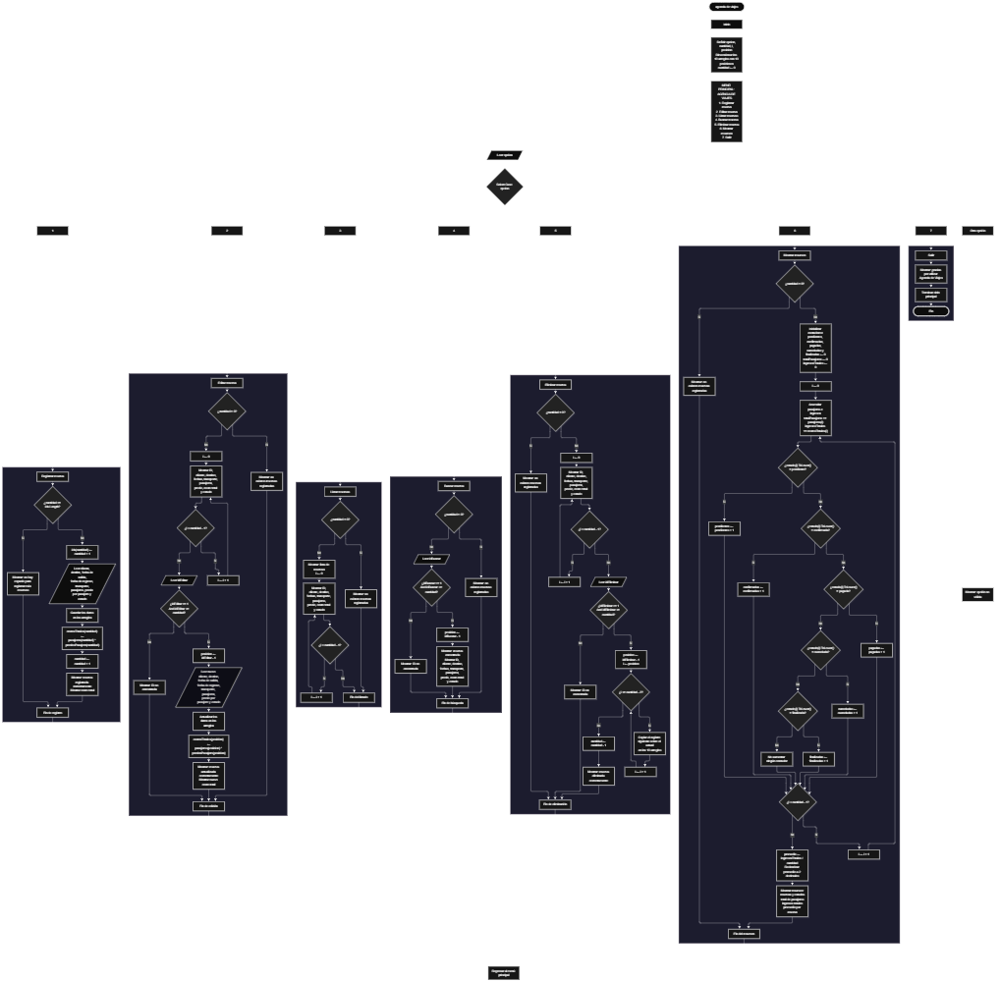

Este proyecto, llamado <b>agencia de viajes</b>, fue desarrollado en <b>visual basic .net</b> como un ejercicio práctico para fortalecer la lógica de programación mediante la creación de un sistema de gestión de reservas de viajes desde la consola. El programa cuenta con un menú principal de siete opciones que permite <b>registrar, editar, eliminar, buscar, listar y consultar un resumen</b> de las reservas almacenadas. Cada reserva administra información como el cliente, el destino, las fechas de salida y regreso, el transporte, la cantidad de pasajeros, el precio por pasajero, el costo total y el estado de la reserva, utilizando arreglos con una capacidad máxima de <b>10 reservas durante la ejecución</b>. Durante su desarrollo se aplicaron conceptos fundamentales de programación, como variables, arreglos, estructuras condicionales, ciclos repetitivos y estructuras de selección, además de operaciones para calcular costos, acumular ingresos, contar pasajeros y organizar registros. Este proyecto permite poner en práctica los conocimientos adquiridos en Visual Basic .NET y sirve como base para desarrollar sistemas de gestión más avanzados utilizando otros lenguajes y tecnologías.

<h2 align="center">⚙️ Funcionamiento del menú principal</h2>

### ➕ Registrar reserva

La opción <b>1) registrar reserva</b> permite almacenar una nueva reserva de viaje. Antes de realizar el registro, el sistema comprueba que la cantidad de reservas almacenadas sea menor a <b>10</b>, utilizando la condición <b>cantidad &lt; ids.Length</b>. Si existe espacio disponible, genera automáticamente un identificador mediante la expresión <b>cantidad + 1</b> y solicita los datos del <b>cliente, destino, fecha de salida, fecha de regreso, transporte, cantidad de pasajeros, precio por pasajero y estado</b>. Los datos se almacenan en la posición correspondiente de sus respectivos arreglos. Después, calcula el costo total mediante la multiplicación de la cantidad de pasajeros por el precio individual, utilizando la operación <b>pasajeros(cantidad) * preciosPasajero(cantidad)</b>. Finalmente, aumenta la variable <b>cantidad</b> en uno y muestra el mensaje <b>"reserva registrada correctamente."</b>, junto con el costo total calculado. Si se alcanza la capacidad máxima, presenta el mensaje <b>"no hay espacio para registrar más reservas."</b>, impidiendo agregar otro registro.

### ✏️ Editar reserva

La opción <b>2) editar reserva</b> permite modificar la información de una reserva registrada. Primero, el programa comprueba si existen reservas almacenadas mediante la variable <b>cantidad</b>. Si no hay registros, muestra el mensaje <b>"no existen reservas registradas."</b>. En caso contrario, presenta una lista con el identificador, cliente, destino, fechas, transporte, pasajeros, precio por pasajero, costo total y estado de cada reserva. Después, solicita el ID de la reserva que se desea editar y comprueba que esté dentro del rango permitido mediante la condición <b>idEditar &gt;= 1 And idEditar &lt;= cantidad</b>. Si la selección es válida, calcula la posición utilizando <b>idEditar - 1</b> y solicita los nuevos datos del cliente, destino, fechas de salida y regreso, transporte, cantidad de pasajeros, precio por pasajero y estado. Los valores se actualizan directamente en los arreglos correspondientes. Posteriormente, vuelve a calcular el costo total multiplicando los nuevos pasajeros por el nuevo precio individual. Finalmente, presenta el mensaje <b>"reserva actualizada correctamente."</b> y muestra el nuevo costo total. Si el ID introducido no está dentro del rango permitido, informa que la reserva no fue encontrada.

### 📋 Listar reservas

La opción <b>3) listar reservas</b> permite visualizar todas las reservas registradas actualmente en el sistema. Antes de mostrar la información, el programa comprueba si la variable <b>cantidad</b> es igual a cero. Si no existen registros, presenta el mensaje <b>"no existen reservas registradas."</b>. Si hay reservas disponibles, muestra el encabezado <b>"lista de reservas"</b> y utiliza un ciclo <b>For...Next</b> para recorrer los arreglos desde la primera posición hasta la última reserva registrada. Durante el recorrido, muestra el ID, cliente, destino, fecha de salida, fecha de regreso, transporte, cantidad de pasajeros, precio por pasajero, costo total y estado de cada reserva. Esta función facilita consultar los registros existentes sin necesidad de buscar cada reserva individualmente.

### 🔎 Buscar reserva

La opción <b>4) buscar reserva</b> permite localizar una reserva mediante su identificador. Primero, el programa comprueba si existen reservas registradas. Si no hay información almacenada, muestra el mensaje <b>"no existen reservas registradas."</b>. En caso contrario, solicita el ID de la reserva que se desea buscar y comprueba que esté dentro del rango permitido mediante la condición <b>idBuscar &gt;= 1 And idBuscar &lt;= cantidad</b>. Si el ID es válido, calcula la posición correspondiente mediante <b>idBuscar - 1</b> y muestra el encabezado <b>"reserva encontrada"</b>, seguido de toda la información almacenada: cliente, destino, fechas, transporte, pasajeros, precio por pasajero, costo total y estado. Si el identificador introducido no corresponde al rango permitido, presenta el mensaje <b>"ID no encontrada."</b>. La búsqueda utiliza directamente la posición calculada a partir del identificador, sin recorrer los arreglos para comparar cada ID.

### 🗑️ Eliminar reserva

La opción <b>5) eliminar reserva</b> permite eliminar una reserva registrada mediante su identificador. Antes de comenzar, el programa comprueba que existan reservas almacenadas. Si no hay registros, muestra el mensaje <b>"no existen reservas registradas."</b>. Si hay reservas disponibles, presenta una lista con la información completa de cada una. Después, solicita el ID de la reserva que se desea eliminar y verifica que se encuentre dentro del rango permitido mediante la condición <b>idEliminar &gt;= 1 And idEliminar &lt;= cantidad</b>. Si el ID es válido, calcula la posición utilizando <b>idEliminar - 1</b> y comienza el proceso de eliminación. Para mantener los registros organizados, utiliza un ciclo <b>For...Next</b> controlado por la variable <b>i</b>, que desplaza una posición hacia la izquierda los datos de las reservas posteriores en los diez arreglos: <b>ids, clientes, destinos, fechasSalida, fechasRegreso, transportes, pasajeros, preciosPasajero, costosTotales y estados</b>. Posteriormente, disminuye la variable <b>cantidad</b> en uno y muestra el mensaje <b>"reserva eliminada correctamente."</b>. El programa reorganiza los datos almacenados, pero no renumera los identificadores después de la eliminación.

### 📊 Mostrar resumen

La opción <b>6) mostrar resumen</b> permite consultar estadísticas generales de las reservas registradas. Primero, el programa comprueba si existen registros almacenados. Si la cantidad es igual a cero, muestra el mensaje <b>"no existen reservas registradas."</b>. En caso contrario, inicializa los contadores <b>pendientes, confirmadas, pagadas, canceladas y finalizadas</b>, además de las variables utilizadas para acumular los pasajeros y los ingresos totales. Después, utiliza un ciclo <b>For...Next</b> para recorrer las reservas registradas. Durante el recorrido, compara el estado de cada reserva mediante <b>estados(i).ToLower()</b> y aumenta el contador correspondiente cuando encuentra uno de los cinco estados establecidos. También acumula la cantidad de pasajeros mediante <b>totalPasajeros</b> y suma los costos de las reservas mediante <b>ingresosTotales</b>. Al finalizar el recorrido, calcula el promedio de ingresos por reserva utilizando <b>ingresosTotales / cantidad</b> y aplica <b>Math.Round(promedio, 2)</b> para redondear el resultado a dos decimales. Finalmente, muestra la cantidad de reservas, los estados contabilizados, el total de pasajeros, los ingresos totales y el promedio por reserva. El cálculo de ingresos incluye todas las reservas, independientemente de su estado.

### 🚪 Salir del menú principal

La opción <b>7) salir</b> permite finalizar la ejecución del programa y muestra el mensaje <b>"gracias por utilizar agencia de viajes."</b>. El menú principal se encuentra dentro de una estructura repetitiva <b>Do...Loop While</b>, que mantiene el programa en funcionamiento mientras la opción seleccionada sea diferente de <b>7</b>. Cuando el usuario selecciona esta opción, se ejecuta el mensaje de despedida y la condición <b>opcion &lt;&gt; 7</b> deja de cumplirse, finalizando el ciclo y la ejecución del programa.

<h2 align="center">🧠 Temas aplicados en el proyecto</h2>

### 📦 Variables

En este proyecto se utilizan variables para controlar la opción seleccionada en el menú, administrar la cantidad de reservas registradas, seleccionar los identificadores que se desean editar, eliminar o buscar, recorrer los arreglos y calcular los resultados del resumen. También se utilizan variables para almacenar temporalmente las posiciones de los registros y acumular las cantidades de pasajeros e ingresos. Cada variable cumple una función específica dentro de las operaciones de gestión de reservas.

🔢 **Opcion:** Almacena la opción seleccionada por el usuario en el menú principal.

📊 **Cantidad:** Controla el número actual de reservas registradas.

🔄 **I:** Funciona como contador en los ciclos utilizados para recorrer los arreglos y reorganizar los registros durante la eliminación.

🔎 **IdEditar:** Almacena el identificador de la reserva que se desea modificar.

🔍 **IdBuscar:** Almacena el identificador de la reserva que se desea consultar.

🗑️ **IdEliminar:** Almacena el identificador de la reserva que se desea eliminar.

📍 **Posicion:** Determina la posición del arreglo correspondiente al identificador seleccionado.

📈 **Pendientes, Confirmadas, Pagadas, Canceladas y Finalizadas:** Almacenan la cantidad de reservas correspondientes a cada estado.

👥 **TotalPasajeros:** Acumula la cantidad de pasajeros de todas las reservas registradas.

💰 **IngresosTotales:** Acumula los costos totales de todas las reservas.

📊 **Promedio:** Almacena el promedio de ingresos por reserva.

### 🗃️ Arreglos

En este proyecto se utilizan diez arreglos relacionados con la información de cada reserva. Cada arreglo tiene una capacidad de <b>10 posiciones</b> y utiliza el mismo índice para representar los datos correspondientes a un mismo viaje. Por ejemplo, la información de una reserva almacenada en la posición <b>0</b> se encuentra distribuida entre <b>ids(0), clientes(0), destinos(0), fechasSalida(0), fechasRegreso(0), transportes(0), pasajeros(0), preciosPasajero(0), costosTotales(0) y estados(0)</b>. Esta organización permite recorrer, consultar, modificar, mostrar y eliminar las reservas de manera ordenada.

🆔 **Ids(10):** Almacena los identificadores de las reservas registradas.

👤 **Clientes(10):** Almacena los nombres de los clientes.

🌎 **Destinos(10):** Almacena los destinos de los viajes.

📅 **FechasSalida(10):** Almacena las fechas de salida de los viajes.

📅 **FechasRegreso(10):** Almacena las fechas de regreso de los viajes.

🚍 **Transportes(10):** Almacena los medios de transporte seleccionados para cada viaje.

👥 **Pasajeros(10):** Almacena la cantidad de pasajeros de cada reserva.

💵 **PreciosPasajero(10):** Almacena el precio individual por pasajero.

💰 **CostosTotales(10):** Almacena el costo total calculado para cada reserva.

📋 **Estados(10):** Almacena el estado de cada reserva.

### 🔀 Estructuras condicionales

En este proyecto se utilizan las estructuras <b>If, ElseIf y Else</b> para comprobar si existe espacio disponible antes de registrar una nueva reserva, verificar si hay registros almacenados antes de ejecutar determinadas operaciones y validar que el identificador introducido esté dentro del rango permitido. También se utilizan condiciones para determinar qué estado corresponde a cada reserva durante la elaboración del resumen. Estas estructuras permiten que el programa responda de manera diferente según la situación de los registros y el resultado de cada comprobación.

### 🔄 Estructuras repetitivas

En este proyecto se utilizan los ciclos <b>For...Next</b> y <b>Do...Loop While</b>. Los ciclos <b>For...Next</b> permiten recorrer los arreglos para mostrar las reservas, consultar sus datos y acumular las cantidades necesarias para elaborar el resumen. Durante la eliminación, también permiten desplazar los datos de las reservas posteriores una posición hacia la izquierda. Por otro lado, el ciclo <b>Do...Loop While</b> mantiene activo el menú principal para que el usuario pueda ejecutar diferentes operaciones antes de seleccionar la opción de salida.

### 🎯 Estructura de selección

El programa utiliza la estructura <b>Select Case</b> para evaluar el valor almacenado en la variable <b>opcion</b> y ejecutar el bloque de instrucciones correspondiente. Cada caso representa una operación específica del sistema: <b>registrar reserva, editar reserva, listar reservas, buscar reserva, eliminar reserva, mostrar resumen o salir</b>. También se utiliza el bloque <b>Case Else</b> para mostrar el mensaje <b>"opción no válida."</b> cuando el usuario introduce un número que no coincide con ninguna de las opciones definidas en el menú.

### 🔢 Dimensionamiento de arreglos

El programa utiliza la instrucción <b>Dim</b> para declarar y establecer la capacidad de los arreglos que almacenan la información de las reservas. Se definieron <b>10 arreglos con 10 posiciones cada uno</b>, utilizando índices desde <b>0 hasta 9</b>. La cantidad de posiciones ocupadas se controla mediante la variable <b>cantidad</b>, mientras que la propiedad <b>ids.Length</b> permite comprobar la capacidad máxima disponible antes de registrar una nueva reserva. De esta manera, el sistema puede administrar hasta 10 reservas durante la ejecución del programa.

### 🔄 Reorganización de registros

Cuando se selecciona una reserva para eliminarla, el programa utiliza un ciclo <b>For...Next</b> que comienza en la posición seleccionada y llega hasta <b>cantidad - 2</b>. En cada repetición, los datos de la posición siguiente se copian sobre la posición actual en los diez arreglos. De esta manera, los registros posteriores ocupan las posiciones disponibles sin dejar espacios vacíos entre las reservas activas. Después, la variable <b>cantidad</b> disminuye en uno. Sin embargo, los identificadores originales se conservan y no se renumeran, por lo que la relación entre el ID y la posición puede dejar de coincidir después de eliminar una reserva intermedia.

<h2 align="center">¿Cómo se implementaron las operaciones crud en el proyecto?</h2>

Las operaciones <b>crud</b> se implementaron mediante las opciones del menú principal, permitiendo administrar las reservas de viajes registradas. La operación <b>crear</b> corresponde a <b>registrar reserva</b>, donde se introducen los datos de un nuevo viaje y se calcula su costo total; <b>leer</b> se realiza mediante las opciones <b>buscar reserva, listar reservas y mostrar resumen</b>, que permiten consultar los datos individuales y las estadísticas generales; <b>actualizar</b> corresponde a <b>editar reserva</b>, donde se modifican los datos de una reserva y se recalcula su costo total; y <b>eliminar</b> se realiza mediante la opción <b>eliminar reserva</b>, que desplaza los registros posteriores para reorganizar los arreglos. Estas operaciones utilizan variables, arreglos, condicionales y ciclos para gestionar la información almacenada temporalmente durante la ejecución del programa.

<h2 align="center">Diagrama de flujo del proyecto</h2>

<h2 align="center">🛡️ Validaciones del programa</h2>

### 📭 No existen reservas registradas

Esta validación se utiliza en las opciones de <b>editar, listar, buscar, eliminar y mostrar resumen</b>. El programa comprueba si la variable <b>cantidad</b> es igual a <b>0</b> y, si no existen reservas registradas, muestra el mensaje <b>"no existen reservas registradas."</b>. Esta comprobación evita continuar con las operaciones que necesitan información almacenada cuando el sistema está vacío.

### ⚠️ Capacidad máxima de reservas

Esta validación se utiliza durante el registro de nuevas reservas para controlar la capacidad máxima de los arreglos. El programa comprueba si <b>cantidad &gt;= ids.Length</b> antes de permitir agregar un nuevo registro. Si existe espacio disponible, genera el identificador, solicita los datos y aumenta el contador. En caso contrario, muestra el mensaje <b>"no hay espacio para registrar más reservas."</b>, impidiendo registrar más viajes mientras se mantenga la capacidad máxima de 10 reservas.

### 🔢 Identificador de reserva no encontrado

Esta validación se utiliza durante las operaciones de <b>editar, buscar y eliminar reservas</b>. El programa comprueba que el identificador introducido sea mayor o igual a <b>1</b> y menor o igual a <b>cantidad</b>. Si el ID se encuentra dentro de ese rango, calcula la posición mediante la expresión <b>ID - 1</b> y ejecuta la operación correspondiente. Si el identificador está fuera del rango permitido, muestra el mensaje <b>"ID no encontrada."</b>. Esta comprobación controla el rango de selección, aunque no verifica que el identificador calculado coincida con el ID real almacenado después de una eliminación intermedia.

### 💰 Cálculo del costo total

El programa calcula automáticamente el costo total de cada reserva mediante la multiplicación de la cantidad de pasajeros por el precio individual. Utiliza la operación <b>pasajeros(posicion) * preciosPasajero(posicion)</b> tanto durante el registro como durante la edición. De esta manera, cuando se modifica la cantidad de pasajeros o el precio individual, el costo total se actualiza utilizando los nuevos valores.

### 📊 Cálculo del resumen

Durante la elaboración del resumen, el programa utiliza contadores para clasificar las reservas en cinco estados: <b>pendiente, confirmada, pagada, cancelada y finalizada</b>. También acumula el número total de pasajeros y los costos de todas las reservas registradas. Finalmente, calcula el promedio de ingresos dividiendo los ingresos totales entre la cantidad de reservas y redondea el resultado a dos decimales mediante <b>Math.Round(promedio, 2)</b>. Los ingresos acumulados incluyen todas las reservas, sin realizar distinciones según su estado.

### ⚠️ Conversión de datos numéricos

El programa utiliza <b>Convert.ToInt32()</b> para convertir los valores introducidos correspondientes a la cantidad de pasajeros y los identificadores, y <b>Convert.ToDouble()</b> para convertir los precios por pasajero. Estas conversiones permiten almacenar los valores en sus respectivos tipos numéricos. Sin embargo, el código no utiliza <b>TryParse</b> ni mecanismos de control de excepciones, por lo que una entrada que no pueda convertirse puede provocar un error durante la ejecución.

### 🔄 Reorganización e identificadores

Durante la eliminación de una reserva, el programa desplaza los datos de los arreglos una posición hacia la izquierda y disminuye la cantidad de registros. Sin embargo, no vuelve a generar los identificadores después de reorganizar los datos. Como las operaciones de edición, búsqueda y eliminación calculan la posición mediante <b>ID - 1</b>, esta forma de reorganización puede provocar que se acceda a una reserva diferente de la esperada cuando se elimina un registro intermedio.

### ⚠️ Opción inválida

La estructura <b>Select Case</b> incluye el bloque <b>Case Else</b>, que muestra el mensaje <b>"opción no válida."</b> cuando el usuario introduce un número que no corresponde a ninguna de las opciones definidas en el menú. Esta comprobación permite informar al usuario cuando selecciona una operación que no está disponible.

<h2 align="center">🎯 Objetivo del proyecto</h2>

El objetivo principal de este proyecto es fortalecer la <b>lógica de programación</b> mediante el desarrollo de un sistema de gestión de reservas de viajes en <b>visual basic .net</b>. A través de su construcción se busca aplicar los conocimientos adquiridos sobre variables, arreglos, estructuras condicionales, ciclos repetitivos y estructuras de selección, integrándolos para resolver un problema de manera organizada. Además, el proyecto permite comprender cómo registrar, consultar, modificar y eliminar información, realizar cálculos automáticos de costos y generar estadísticas sobre las reservas, estableciendo una base para desarrollar sistemas de gestión más completos con otros lenguajes y tecnologías.

